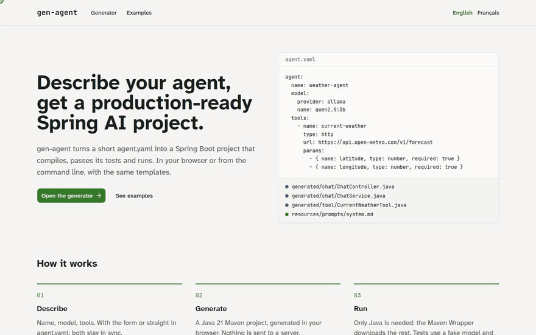
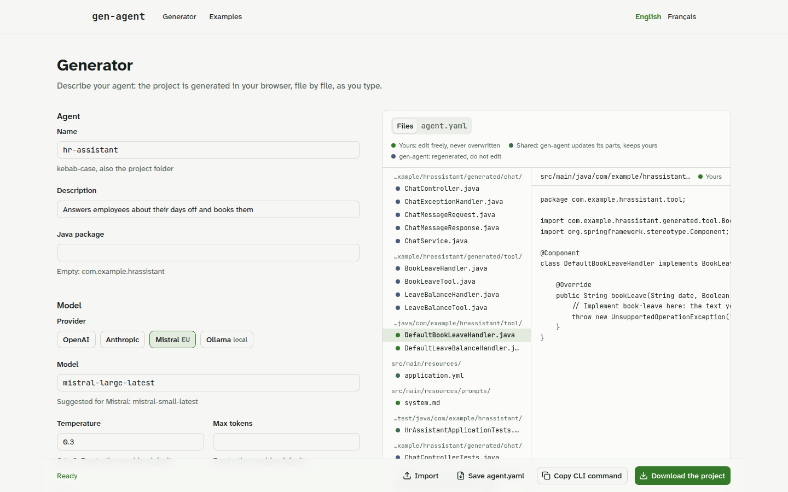
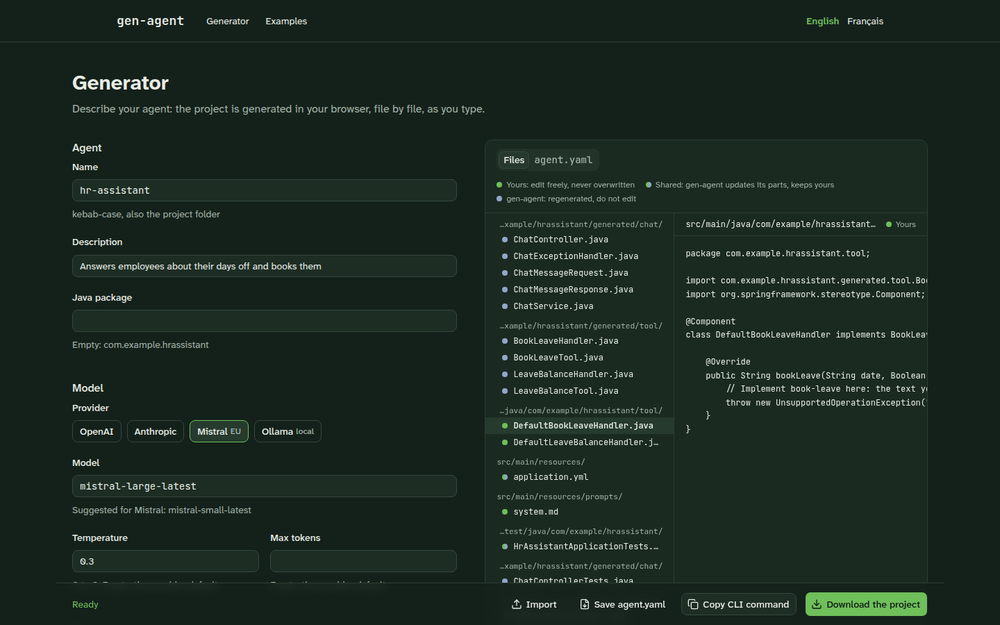

# gen-agent

> Describe your agent, get a production-ready Spring AI project.

gen-agent is an open source generator of [Spring AI](https://spring.io/projects/spring-ai) agents, in the spirit of
JHipster: describe your agent in an `agent.yaml` file (or answer a few questions) and get a complete Spring Boot project
that compiles, passes its tests and runs.

**Status:** `minimal` profile, from the command line or a web generator that runs entirely in your browser. See
[what is not done yet](#limits).



<sub>The web generator: pick an example, change it, watch the files follow, download the project. The browser renders
exactly what the CLI writes, with the same templates.</sub>

## Web generator

A form and an `agent.yaml` editor kept in sync, a live preview of every generated file with who owns it, ready-made
examples, and a zip of the project. Nothing leaves the browser: validation, templates and Java formatting run client
side.

| Generator                                                                        | Dark mode                                                      |
| -------------------------------------------------------------------------------- | -------------------------------------------------------------- |
|  |  |

```bash
pnpm install
pnpm build                              # core and templates, used by the site
pnpm --filter @gen-agent/web dev        # http://localhost:3000
```

## Command line


<sub>Recorded with a local model (Ollama, qwen2.5:3b): the agent calls the Open-Meteo API through its generated HTTP
tool and remembers the conversation. Script: [`docs/demo`](docs/demo).</sub>

### Quick start

```bash
npx gen-agent new my-assistant          # answer a few questions
npx gen-agent generate --from agent.yaml
```

Then:

```bash
cd my-assistant
export MISTRAL_API_KEY=...              # or OPENAI_API_KEY, ANTHROPIC_API_KEY; nothing for Ollama
./mvnw spring-boot:run
curl -s localhost:8080/api/chat -H 'Content-Type: application/json' -d '{"message": "Hello"}'
```

## From an existing API

Point gen-agent at an OpenAPI 3 spec: each operation becomes a tool the agent can call.

```bash
gen-agent import openapi https://petstore3.swagger.io/api/v3/openapi.json \
  --include findPetsByStatus,getPetById
gen-agent generate --from agent.yaml
```

The spec is saved under `specs/` and `agent.yaml` refers to it, so the tools follow the API when you regenerate;
`--expand` copies them into `agent.yaml` instead, to edit their descriptions. Path, query and JSON body parameters,
bearer tokens and API key headers (read from environment variables) are supported. What a tool cannot send (file
uploads, nested bodies, required business headers) is skipped and the reason is printed.

## Describe your agent

```yaml
agent:
  name: hr-assistant
  description: Internal HR assistant
  model:
    provider: mistral # openai | anthropic | mistral | ollama
    name: mistral-large-latest
    temperature: 0.3
  tools:
    - name: weather-forecast
      type: http
      description: Weather forecast for a location
      url: https://api.open-meteo.com/v1/forecast
      params:
        - { name: latitude, type: number, required: true }
        - { name: longitude, type: number, required: true }
    - name: leave-balance
      type: http
      description: Days off left for an employee
      url: https://hr.example.org/api/employees/{employeeId}/leave # {employeeId} is filled from the parameter
      auth: { type: bearer, env: HR_API_TOKEN } # the token stays in an environment variable
      params:
        - { name: employeeId, type: string, required: true }
    - name: book-leave
      type: java
      description: Books a day off for the current employee
      params:
        - { name: date, type: string, required: true }
  gdpr:
    euOnly: true # refuses providers hosted outside the EU
```

The file is validated before anything is written: unknown keys, wrong values and API keys pasted in clear are refused,
with the line of each error. Its JSON Schema (`packages/core/schema/agent.schema.json`) gives validation and
autocompletion in your editor.

## What you get

A Spring Boot 4.1.1 / Spring AI 2.0.1 / Java 21 Maven project, with the Maven Wrapper (only Java is needed):

- a `ChatClient` with the system prompt in `src/main/resources/prompts/system.md` and a windowed conversation memory;
- `POST /api/chat`, validated input, errors as `ProblemDetail`, replies flagged `"aiGenerated": true` (EU AI Act);
- each HTTP tool as a `RestClient` call with its URL in `application.yml`: path, query or JSON body parameters, values
  from the model encoded so they cannot change the path, an optional bearer or API key header read from an
  environment variable, and responses cut before they fill the model's context; each Java tool as an interface you
  implement;
- tests that start the application with a fake model: `./mvnw verify` never calls a provider and costs nothing.

Generated code and your code never mix: everything under `…generated` belongs to gen-agent, the tool implementations
and the system prompt belong to you, and `.gen-agent.json` records who owns each file and its fingerprint, so future
versions can regenerate safely ([ADR 0001](docs/adr/0001-separate-generated-and-user-code.md)).

## Limits

- Only the `minimal` profile. A valid `agent.yaml` may describe the whole specification (`profile: production`, RAG,
  MCP, security, cache…); gen-agent then refuses to generate and says which version brings each feature.
- Maven only; Spring AI version pinned to 2.0.1.
- `generate` writes into a new or empty directory; `add` and `upgrade` come later.

## Contributing

Node 22+, pnpm, JDK 21 and Google Chrome (for the web tests).

```bash
pnpm install
pnpm lint && pnpm typecheck && pnpm test   # unit and snapshot tests
pnpm e2e                                   # mvn verify on the reference projects, then the web generator in Chrome
```

The end-to-end tests download a project from the web generator, check it is identical to the CLI output and build it
with its Maven Wrapper; they also check the pages with [axe](https://github.com/dequelabs/axe-core).

| Package              | Role                                                                          |
| -------------------- | ----------------------------------------------------------------------------- |
| `packages/core`      | `agent.yaml` schema and rules, normalized model, rendering (Node and browser) |
| `packages/templates` | templates of the `minimal` profile, reference agents and their snapshots      |
| `packages/cli`       | the `gen-agent` command                                                       |
| `packages/web`       | the web generator (Next.js static export, English and French)                 |
| `e2e`                | Maven builds of the reference projects, Playwright tests of the web generator |

## License

[Apache License 2.0](LICENSE)
