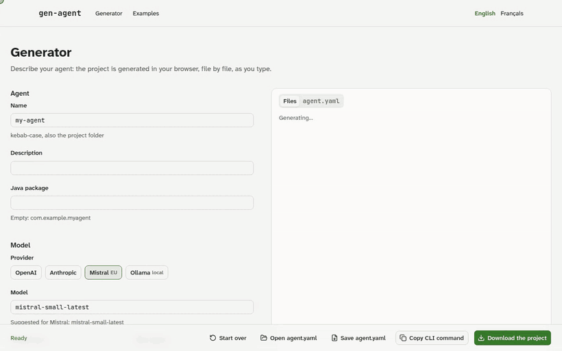

# gen-agent guide

Everything gen-agent does, in detail. The [README](../README.md) is the short version.

## From an existing API

Point gen-agent at an OpenAPI 3 spec: each operation becomes a tool the agent can call.

```bash
gen-agent import openapi https://petstore3.swagger.io/api/v3/openapi.json \
  --include findPetsByStatus,getPetById
gen-agent generate --from agent.yaml
```

The spec is saved under `specs/` and `agent.yaml` refers to it, so the tools follow the API when you regenerate;
`--expand` copies them into `agent.yaml` instead, to edit their descriptions. Path, query and JSON body parameters,
bearer tokens and API key headers (read from environment variables) are supported. What a tool cannot send (file
uploads, nested bodies, required business headers) is skipped and the reason is printed. A public API whose spec
declares a security it does not enforce (the Petstore does) is imported with `--no-auth`: no token to set.

## Web generator

A form and an `agent.yaml` editor kept in sync, a live preview of every generated file with who owns it, OpenAPI
import, ready-made examples, and a zip of the project. Nothing leaves the browser: validation, templates and Java
formatting run client side, and the browser renders exactly what the CLI writes.



| Generator                                                                   | Dark mode                                                 |
| --------------------------------------------------------------------------- | --------------------------------------------------------- |
|  |  |

```bash
pnpm install
pnpm build                              # the packages the site uses
pnpm --filter @gen-agent/web dev        # http://localhost:3000
```

## From your coding assistant (MCP)

`gen-agent mcp` serves gen-agent to Claude Code, Cursor or any MCP client, on stdio:

```bash
claude mcp add gen-agent -- npx gen-agent mcp
```

```json
{ "mcpServers": { "gen-agent": { "command": "npx", "args": ["gen-agent", "mcp"] } } }
```

| Tool               | What it does                                                                           |
| ------------------ | -------------------------------------------------------------------------------------- |
| `validate_agent`   | checks an `agent.yaml`, each problem with its line                                     |
| `import_openapi`   | turns a spec of the workspace (or an https URL) into tools, with what it skips and why |
| `preview_project`  | lists the files and who owns them, shows one on request                                |
| `generate_project` | writes the project into a new or empty directory of the workspace, never outside it    |

The `agent.yaml` JSON Schema is a resource (`gen-agent://schema/agent.json`), so the assistant writes valid files.

## Command line


<sub>Recorded with a local model (Ollama, qwen2.5:3b): the agent calls the Open-Meteo API through its generated HTTP
tool and remembers the conversation. Script: [`docs/demo`](demo).</sub>

```bash
npx gen-agent new my-assistant          # answer a few questions
npx gen-agent new my-assistant --provider ollama --model qwen2.5:7b   # or none: for scripts and CI
npx gen-agent generate --from agent.yaml
```

Grow the project later without losing your changes:

```bash
gen-agent add tool order-status --url 'https://shop.example.org/orders/{orderId}' --param orderId:string:required
gen-agent add tool cancel-order --type java --approval \
  --param 'orderId:string:required:the id printed on the receipt'   # each call waits for the user
gen-agent add mcp files --package @modelcontextprotocol/server-filesystem --version 2.0.0 --arg /srv/docs
gen-agent update        # after editing agent.yaml by hand
```

Generated files are rewritten, your files never are, and a shared file you changed (README, `pom.xml`…) gets the new
version next to it as `<file>.gen-agent-new`, to merge. A generated file you edited anyway is rewritten too, your
version kept as `<file>.gen-agent-old`. What is no longer generated (a tool removed from `agent.yaml`) is deleted when
nobody changed it, and listed when you did.

Then:

```bash
cd my-assistant
export MISTRAL_API_KEY=...              # or OPENAI_API_KEY, ANTHROPIC_API_KEY; nothing for Ollama
./mvnw spring-boot:run
curl -s localhost:8080/api/chat -H 'Content-Type: application/json' -d '{"message": "Hello"}'
```

An agent that needs Postgres or Redis without Docker Compose (a `minimal` agent with RAG, for instance) runs with
`./mvnw spring-boot:test-run` (`./gradlew bootTestRun`): its services start in Docker, as in its tests.

Complete agents, with the commands that made them and the code written by hand, are in [`examples/`](../examples).

## Profiles

| Profile      | What the agent comes with                                                                                                                                                                                                                                                                                                                                                                                                                                                                                                                                                                                                                                                                                                                                                    |
| ------------ | ---------------------------------------------------------------------------------------------------------------------------------------------------------------------------------------------------------------------------------------------------------------------------------------------------------------------------------------------------------------------------------------------------------------------------------------------------------------------------------------------------------------------------------------------------------------------------------------------------------------------------------------------------------------------------------------------------------------------------------------------------------------------------- |
| `minimal`    | the agent alone: chat endpoint, memory, tools; nothing else to run                                                                                                                                                                                                                                                                                                                                                                                                                                                                                                                                                                                                                                                                                                           |
| `standard`   | conversations in Postgres, OIDC sign-in (each user sees only their conversations), request and token limits per user, cache of first answers (Redis, per user, never for answers built from a tool), OpenTelemetry traces and metrics with a Prometheus endpoint, a Dockerfile and a `compose.yaml` with Postgres, Redis, Keycloak and Grafana; optionally a chat page (`interface: [rest, chat-ui]`) where users sign in from the browser                                                                                                                                                                                                                                                                                                                                   |
| `production` | `standard`, and personal data protected: emails, phones, IBANs, card and social security numbers masked before the model and in the logs (put back in answers and tool calls), `DELETE /api/me` and an admin erasure endpoint, conversations purged after 30 days, a semantic cache per user in pgvector; prompt injection refused before the model, tool results treated as untrusted data, answers that leak the system prompt refused and API keys masked, at most 8 tool calls and 60s per request; retries, a circuit breaker and a fallback answer when no model can answer; kill switches for the agent and each tool; evaluations and red teaming on Ollama (`./mvnw verify -Pevals`, run by a generated GitHub Actions workflow), a Grafana dashboard, a Helm chart |

```yaml
agent:
  name: support-desk
  profile: standard # every piece can still be changed: memory, security, deploy
  security:
    rateLimit: 30/min
    tokenBudget: 100000/day
```

`docker compose up --build` starts a `standard` agent with its services, a test user and Grafana; its tests run
against real Postgres and Redis containers (Testcontainers).

Any agent can fall back to another model or provider, send simple messages to a smaller model and summarize long
conversations:

```yaml
model:
  provider: mistral
  name: mistral-medium-latest
  routing: { strategy: rules, simple: mistral-small-latest, complex: mistral-medium-latest }
  fallback: { provider: ollama, name: qwen2.5:3b }
memory:
  summarize: true
```

A tool can wait for the approval of the user who asked: the reply lists the call, and nothing happens until they
approve it (`POST /api/approvals/{id}`, or the buttons of the chat page):

```yaml
tools:
  - name: block-card
    type: java
    approval: { required: true, expiresAfter: 1h }
```

Any agent can answer from documents: the files of `documents/` (PDF, Word, HTML, Markdown… read by Apache Tika) are
indexed in pgvector at startup, and administrators can upload more:

```yaml
rag:
  enabled: true
  topK: 4
  rerank: true
```

Any agent can also use existing MCP servers: remote ones over Streamable HTTP, or packages it starts, in a hardened
container of their own by default (offline, read-only, no Linux capability, bounded memory, CPU and processes):

```yaml
mcp:
  - name: github
    url: https://api.githubcopilot.com/mcp/
    auth: { type: bearer, env: GITHUB_TOKEN } # the name of the variable, never its value
  - name: time
    package: mcp-server-time
    version: 2026.10.19 # exact: latest is refused
    runtime: python # network: true for a server that calls an API
```

## Describe your agent

```yaml
agent:
  name: hr-assistant
  description: Internal HR assistant
  model:
    provider: mistral # openai | anthropic | mistral | ollama
    name: mistral-large-latest
    temperature: 0.3
  tools:
    - name: weather-forecast
      type: http
      description: Weather forecast for a location
      url: https://api.open-meteo.com/v1/forecast
      params:
        - { name: latitude, type: number, required: true }
        - { name: longitude, type: number, required: true }
    - name: leave-balance
      type: http
      description: Days off left for an employee
      url: https://hr.example.org/api/employees/{employeeId}/leave # {employeeId} is filled from the parameter
      auth: { type: bearer, env: HR_API_TOKEN } # the token stays in an environment variable
      params:
        - { name: employeeId, type: string, required: true }
    - name: book-leave
      type: java
      description: Books a day off for the current employee
      params:
        - { name: date, type: string, required: true }
  gdpr:
    euOnly: true # refuses providers hosted outside the EU
```

The file is validated before anything is written: unknown keys, wrong values and API keys pasted in clear are refused,
with the line of each error. Its JSON Schema (`packages/core/schema/agent.schema.json`) gives validation and
autocompletion in your editor.

## What you get

A Spring Boot 4.1.1 / Spring AI 2.0.1 / Java 21 project built with Maven or Gradle (`build: gradle`), with its wrapper (only
Java is needed):

- a `ChatClient` with the system prompt in `src/main/resources/prompts/system.md` and a windowed conversation memory;
- `POST /api/chat`, validated input, errors as `ProblemDetail`, replies flagged `"aiGenerated": true` (EU AI Act);
- each HTTP tool as a `RestClient` call with its URL in `application.yml`: path, query or JSON body parameters, values
  from the model encoded so they cannot change the path, an optional bearer or API key header read from an
  environment variable, and responses cut before they fill the model's context; each Java tool as an interface you
  implement;
- tests that start the application with a fake model: `./mvnw verify` never calls a provider and costs nothing.

Generated code and your code never mix: everything under `…generated` belongs to gen-agent, the tool implementations
and the system prompt belong to you, and `.gen-agent.json` records who owns each file and its fingerprint, so future
versions can regenerate safely ([ADR 0001](adr/0001-separate-generated-and-user-code.md)).

## Limits

- Prompt injection detection uses patterns: it makes attacks harder without ruling them out. Measured on attacks it
  was not written from, it caught 8 out of 30, with no false alarm on 40 ordinary customer messages. What holds when
  it misses is architectural: approvals and kill switches are enforced in code, answers that repeat the system prompt
  are refused on the way out, tool results are data. PII masking works with patterns too: names and addresses are not
  detected.
- Spring AI is pinned to 2.0.1. `generate` writes into a new or empty directory; `add` and `update` grow an existing
  project; `upgrade` to a new version of gen-agent comes later.
- MCP servers in containers see none of the files of the host, and do not run under Docker Compose (the agent's
  container has no Docker); remote MCP servers do.
- OpenAPI import: JSON bodies must be flat objects, and OAuth 2 flows are not run (an access token is read from an
  environment variable instead).
